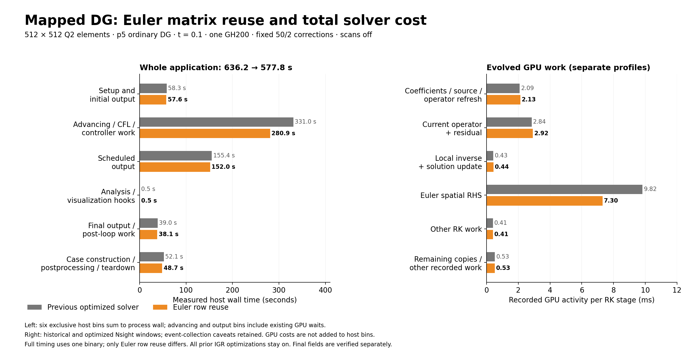

# Mapped DG Euler weak-divergence reuse: qualified full run and counters

The same-GPU full comparison reduces application wall time from **636.212 to 577.786 seconds** (9.183% less time; 1.101× speedup). Advancing/CFL work falls from **330.966 to 280.933 seconds** (15.117% less). Complete final fields are byte-identical. Fresh Nsight Compute shows the targeted kernel is 2.166× faster, with 58.696% fewer L1/TEX request bytes and unchanged FP64 multiply-add work.

This is one sequential paired measurement on a fixed large case. It compares the previous optimized solver with Euler row reuse; it is not a new original-GPU-to-current comparison.

## Exact source and case

- Numerical source: `7dc3052e4a22ed6e34adff86e0a1f2403ffaff70`, based on `33d23c2ccccd32ea2f9549784b8b38f80194e286`.
- Both full arms use the same frozen application, SHA-256 `bf231d1a649f147bfe4aecf283d9a91a19d69b730b49593922a494f1d978a90a`.
- Only the Euler selector changes: `IGRLAB_DG_WEAKDIV_ROW_REUSE=0` versus `1` (legacy alias `DG_IGR_DG_WEAKDIV_ROW_REUSE`). Output directories differ; all physical arguments and other solver controls match.
- 512×512 fixed Q2-mapped elements, 262,144 elements, ordinary DG p5, 9,437,184 scalar nodal DOFs; L2/BrokenL2, max-h `c_alpha=1/6`, CFL 0.3, SSPRK3, final time 0.1, VTK cadence 0.02, no restart.
- Projected FP64 WMMA local IGR, 50 initial/two regular corrections, damping 0.7. Previous compact-volume, fused-residual, fused-update, stage-refresh and tensor-face improvements remain enabled in both arms.
- Optional nonfinite/admissibility scans, positivity limiting and modal limiting remain off. Final-field validation is separate postprocessing.
- Full job **3445369**, GH200 on `gh042`, account `bdiy-dtai-gh`, partition `ghx4`, constraint `projects`, one GPU, eight CPUs/96G, OMP1. Both applications use node-local `/tmp` and `PMIX_MCA_gds=hash`.

The new kernel assigns one row to each thread and reuses its physical weak-divergence matrix coefficients across four independent Euler accumulators. FP64 arithmetic and the original per-equation accumulation order are preserved. It supports the existing mapped 2D/four-equation dense-row path and retains its fallbacks. It adds no TF32 or tensor-core operations to Euler; the existing FP64 WMMA IGR inverse remains enabled. Dense operator storage is unchanged.

## Full application time

Both arms reach t=0.1 with 6,663 accepted steps, 19,990 sigma calls, 40,028 corrections and zero rejected steps. These six host wall-time bins sum to whole-process time:

| Portion | Baseline (s) | Row reuse (s) | Row-reuse wall share |
|---|---:|---:|---:|
| Case setup and initial output | 58.298 | 57.556 | 9.96% |
| Advancing, CFL and remaining loop work | 330.966 | 280.933 | 48.62% |
| Scheduled output, staging and existing waits | 155.391 | 151.984 | 26.30% |
| Configured analysis/visualization hooks | 0.517 | 0.482 | 0.08% |
| Final output and case postloop reports | 38.951 | 38.128 | 6.60% |
| Outside case scope: pre/post work and lifecycle | 52.090 | 48.702 | 8.43% |
| **Whole application** | **636.212** | **577.786** | **100%** |

The output bins include staging and existing waits, not just filesystem writes. Their roughly 190 seconds remain part of the matched workload even on `/tmp`. Asynchronous GPU work can cross host phase boundaries; these are not exclusive GPU kernel timings. Field hashing, field comparison and retained-result copy-back happen after the timed applications.

One-second samples with GPU utilization at least 90% after 130 seconds show SM-clock medians of 1,965 MHz for baseline and 1,920 MHz for row reuse; memory-clock medians are 2,619 MHz in both. Sampled maximum device allocation is 24,355 MiB in both. Clocks were not locked or identical, no clock normalization is applied, and one pair does not establish run-to-run variability.

The right panel reuses the valid Nsight Systems captures: historical baseline **3444260** and row-reuse **3444685**. Their windows contain 305/359 complete RK steps, respectively. The row-reuse profile measures weak divergence 4.843→2.248 ms/stage, Euler spatial RHS 9.823→7.305 ms/stage, and whole RK 48.382→41.228 ms. These are separate sampled GPU windows; they are neither summed into host wall time nor extrapolated across the full trajectory. Original trace warnings and window-selection limits remain in the saved records.

## Fresh Nsight Compute result

Job **3445658** on `gh009` completed in 3:09. It continuously evolved the same frozen application to RK/Step1200, captured two adjacent launches each of face lift, weak divergence and inverse mass, and deliberately ended that diagnostic application. All six expected launches and all 18 requested counters plus LaunchStats were present. The valid baseline capture is **3444580**, source `c42cb2710255f13e41ad61a76aa8dac51b07d078`, binary `ce68e27c50e3cf2cd5f93cf456f404f667fcfe575590e46fb3cf6f82db79f5eb`.

Both counter captures use the same fixed case, six-launch selection, Nsight Compute 2025.2.0, all-cache replay controls and unlocked clocks. Diagnostic output cadence is 0.1; the unprofiled full pair retains 0.02. They may use different GH200 GPUs. Kernel replay timings are descriptive and are not the application-speedup measurement.

| Weak-divergence metric (mean of two launches) | Baseline | Row reuse |
|---|---:|---:|
| Kernel time | 4.851312 ms | 2.240128 ms |
| L1/TEX request bytes (`l1tex__t_bytes.sum`) | 27.783 GB | 11.476 GB |
| L2 bytes (`lts__t_bytes.sum`) | 12.920 GB | 10.336 GB |
| DRAM read+write bytes | 6.795 GB | 6.793 GB |
| FP64 multiply-add instructions | 2,717,908,992 | 2,717,908,992 |
| DRAM throughput / reported sustained peak | 34.82% | 75.385% |
| Registers/thread | 31 | 47 |
| Active occupancy | 97.395% | 59.350% |
| Long-scoreboard stall fraction | 86.125% | 92.690% |
| Measured local load/store traffic and instructions | 0 | 0 |

The unchanged inverse-mass kernel is 1.718336→1.723088 ms (+0.277%); face lift is 1.299600→1.303840 ms (+0.326%). Their L1/TEX bytes and FP64 instruction counts are unchanged. These controls support attributing the large targeted-kernel improvement to row reuse rather than a general faster-device effect in the sampled capture.

Interpretation: the arithmetic is unchanged, while repeated requests within the memory hierarchy fall. Nearly identical DRAM bytes finish in less than half the time; measured read+write bandwidth rises from about 1.40 to 3.03 TB/s. The higher register count lowers occupancy, yet the kernel is faster. The larger long-scoreboard percentage is a fraction of active-warp cycles, not whole-kernel wall time, and does not reverse the observed improvement. The remaining kernel increasingly uses the DRAM bandwidth available under these replay conditions. Aggregate counters do not isolate matrix addresses; zero sampled local traffic is not proof of zero compiler-allocated stack. Metric interpretation follows NVIDIA's [Nsight Compute profiling guide](https://docs.nvidia.com/nsight-compute/ProfilingGuide/) and [peak-performance analysis guidance](https://developer.nvidia.com/blog/the-peak-performance-analysis-method-for-optimizing-any-gpu-workload).

## Accuracy and retained evidence

Previously passed canonical DeltaAI `build.sh` native job **3444604** covers the mapped-DG CPU/CUDA and shared-reference CUDA suites. Short pair **3444610** also passed. Neither the application nor its dependencies were rebuilt for these reruns.

Both new final VTUs are complete 1,160,775,042-byte files with SHA-256 `db4d0b272baa028a1469006dc3a76a72b6fd055a069a0593aff947b01dc4d94b`, identical to the retained valid previous full reference. Size, field declarations and XML footer checks passed before retention. Local native-VTK validation reused independently rehashed identical bytes with explicit provenance; it does not claim a new transfer.

The unchanged comparator reconstructs complete saved Q5 fields on actual fitted Q2 geometry and uses GL8×GL8 quadrature: 16,777,216 samples across all 262,144 cells. All five primary components have zero normalized L2 and sampled Linf differences. Both inputs have sampled minima density 0.4494201726, pressure 1.0003187640 and q_sigma 1.4004462696. The tighter Euler gate requires conserved L2≤1e-10, sigma L2≤1e-8, and primary sampled Linf≤1e-8. This establishes the saved-field comparison; it is not a continuous-domain or between-frame positivity proof. Raw pair records keep their original pending-field flag; the separate bound physical qualification passed.

The earlier full attempt **3444833** is excluded: its files were truncated by the storage failure, so matching incomplete hashes and its raw wall ratio were not qualified results. Failed counter job **3444875** is likewise excluded. Valid native, short and Nsight Systems results remain usable.

New job output stayed in private `/tmp` directories, automatically cleaned after selected retention. Both final-field paths now hard-link the already retained identical reference after complete SHA verification; no additional large field copy is stored. About **25 MiB** of persistent project storage was added for logs, records and the profiler bundle. At completion, user-wide `/projects` usage is **56.016 GiB** and shared project 18799 usage is **80.564 GiB**. No GPU jobs remain. Installed MFEM/Spack dependencies and frozen binaries remain persistent and reusable.

Raw records are under `/projects/bdiy/jarias9/igrlab-deltaai-wmma-20261016/dg-euler-weakdiv-20261023/`: `full-tmp-3445369/` and `ncu-tmp-3445658/`. Their retention maps preserve original scratch-to-retained path/hash identities. Full finals can be opened through `full-tmp-3445369/selected/retained/{baseline,optimized}/Cycle000005/data.pvtu`; intermediate snapshots are intentionally absent. Machine-readable results are in [the benchmark record](benchmarks/dg-euler-weakdiv-20261023.json). The job-local launcher and persistent-dependency policy are documented in [DeltaAI storage](deltaai-storage.md).
