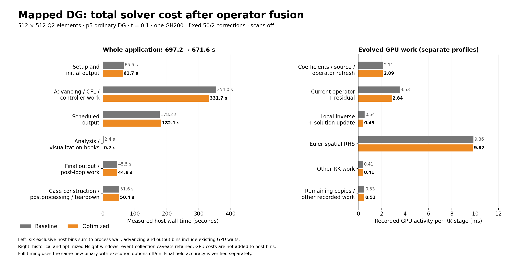

# Mapped-DG operator and residual/update optimization

This pass retains the existing FP64 mapped-DG equation, actual GL7 mass / GL6 diffusion-source quadrature, projected local FP64 WMMA inverse, and fixed 50-initial/two-regular corrections. It changes execution and data movement. The sigma closure remains approximate; this is not a new convergence or precision claim.

## Changes and tested scope

Application source `c42cb2710255f13e41ad61a76aa8dac51b07d078`, branch `igr-operator-residual-fusion`. Canonical native qualification `3444198` passed all eight selected suites. Frozen application SHA-256 `ce68e27c50e3cf2cd5f93cf456f404f667fcfe575590e46fb3cf6f82db79f5eb`.

- Compact volume contractions operate on real D6 / Qmass7 / Qdiff6 dimensions and share the actual reference B/G matrices across element warps. They retain all nonidentity interpolation entries, mapped off-diagonal metrics, current coefficients and original contraction order. Other shapes/backend/storage combinations retain their existing path.
- Fused residual formation accepts proven disjoint MFEM aliases, applies the unchanged volume operator, then completes `rhs - (volume + (0 + ordered_face_sum))` in a dedicated face-gather kernel. It eliminates intermediate staging/vector passes while retaining global face coupling. The separate kernel type preserves the legacy gather implementation and its strict signed-zero/NaN behavior.
- Projected FP64 WMMA can accumulate its correction directly into the solution. The correction is explicitly rounded to FP64 before damping, preserving the previous stored-intermediate semantics. Initial uninitialized sweeps, history/prefetch/output-only behavior, fallback paths and the independent current-A diagnostic remain intact.

The switches remain opt-in, with their existing legacy aliases:

```sh
export IGRLAB_IGR_TENSOR_VOLUME_COMPACT=1
export IGRLAB_IGR_ELEMENT_JACOBI_FUSED_RESIDUAL=1
export IGRLAB_IGR_ELEMENT_JACOBI_FUSED_UPDATE=1
```

The tested combined path is single-rank ordinary CUDA on the fixed 512² Q2-mapped p5 ordinary-DG case. Compact volume admission is based on actual D/Q dimensions, not a Cartesian geometry assumption. Residual admission requires the existing compact exact-face layout and current metadata. The update path requires projected FP64 WMMA. Unsupported configurations retain the prior operations. No MPI or broader p-order performance claim is made.

## Hardware evidence used to choose the changes

Baseline NCU job `3444049` used the previously qualified stage-refresh binary (`b6f20b9`, SHA `cc27f583...`) and continuous t=0 evolution to RK step 1200. It captured exactly two launches of each selected operator kernel, with 18 supported counters plus LaunchStats. Kernel replay used all-cache flush, unlocked clocks and 12 passes per launch. Diagnostic output cadence was 0.1; timing comparisons retain 0.02. The diagnostic application was intentionally terminated after the six selected launches.

| Kernel | Mean replay duration | FP64 activity | DRAM throughput | Long-scoreboard stalls |
|---|---:|---:|---:|---:|
| Generic volume | 870.3 µs | 11.15% | 17.28% | 28.38% |
| Face evaluation/compact lift record | 490.9 µs | 14.30% | 19.69% | 61.17% |
| Face gather | 178.9 µs | 5.01% | 40.38% | 86.45% |

The volume kernel had 44 registers/thread and 12,288 bytes static shared memory; register and shared-memory limits each allowed ten CTAs/SM. All four local-memory load/store counters were measured zero; stack size alone did not indicate spilling. L1 request volume was 5.11 GB for volume and 6.53 GB for face evaluation, but cache request/DRAM ratios do not measure wasted bandwidth. These counters favor reducing requests, dependence chains and intermediate work over assuming FP64 arithmetic saturation. Two replay samples are diagnostic evidence, not whole-run timings or a roofline proof.

## Validation

Canonical `build.sh` on DeltaAI passed `dg_igr_exact_face_cpu`, `dg_igr_exact_face_cuda`, `dg_igr_stage_refresh_cuda`, `dg_igr_tensor_volume_cuda`, `dg_igr_element_block_jacobi_cuda`, `dg_igr_local_tensor_jacobi_cuda_projected_backends`, `dg_igr_time_defaults_tests`, and `dg_igr_explicit_ssprk_cpu`.

Checks retain independent MFEM PA/dense volume oracles; changed device-current coefficients; GL/GLL bases and six explicitly admitted compact cases; unsupported-shape fallback; partial CTAs; signed zero, nonfinite exposure and recovery; full/offset aliases and overlap rejection; stale compact metadata; correction rounding and damping; individual/combined fusion; alternate regular-sweep count; and output-only/prefetch history. A strict NaN-payload regression encountered during development was repaired by isolating the new kernel type; the strict checks were not relaxed.

## Matched short case

Job `3444217` ran baseline then optimized on one GH200, using the same new binary. Both retain the previous fused stage preparation, tensor face density, FP64 Euler rows/faces and projected local inverse. Only the three new execution selectors differ (all zero versus all one); both enable aggregate wall timing. Physics, mesh, CFL, alpha, scans-off policy and output cadence are identical.

Both reached t=0.0025 with 162 steps / 487 sigma calls. The complete final VTUs are byte-identical to each other and to the retained prior stage-refresh result, SHA-256 `375250ef2b14143e3b73c73b580f008b7184b76d2085b9df1d3be790b254e746`. Full Q5/actual-Q2 GL8 comparison reports zero differences. Tight execution-equivalence gates pass without spending an accuracy budget.

| Short timing, seconds | Baseline | Optimized |
|---|---:|---:|
| Pre-final Analysis elapsed | 14.690271 | 14.317787 |
| Native done stopwatch | 58.854976 | 58.128256 |
| Whole application wall | 171.573335 | 167.572784 |

This short run qualifies execution and gives preliminary timing only. Initialization and output dominate it; it is not the full-trajectory performance result.

## Fresh evolved GPU profile

NSys job `3444260` captured 305 complete RK steps / 915 stages after continuous t=0 evolution. Each selected stage has two compact volume applications, two exact face record/residual kernels and two fused projected inverse/update kernels. Recorded launch/device reciprocity and work-count checks pass. Driver/tracing-library compatibility and possible event-loss warnings remain; these are recorded-activity estimates from separate windows/GPUs.

The old standalone subtraction and solution-add kernels are regrouped into the corresponding baseline work groups. New fused kernels cannot be split into pure operator/inverse and residual/update costs.

| Recorded GPU work | Prior stage-refresh window | Optimized window |
|---|---:|---:|
| Current A + residual, ms/correction | 1.763953 | 1.422193 |
| P + solution update, ms/correction | 0.269252 | 0.215137 |
| Full correction sweep, ms | 2.033205 | 1.637330 |
| Total IGR, ms/stage | 6.707878 | 5.892989 |
| Euler spatial RHS, ms/stage | 9.857298 | 9.823297 |
| Complete RK recorded GPU activity, ms/step | 50.929502 | 48.381962 |

IGR recorded activity is about 12.15% lower and complete-RK GPU activity about 5.00% lower. Euler is essentially unchanged. Compact volume costs 1.510874 ms/stage versus the earlier generic volume's 1.722126; it uses 40 registers/thread and 9,040 bytes static shared memory in the native trace. These are descriptive window comparisons, not unprofiled application speedups.

## Total solver accounting

Full pair **3444291** completed baseline then optimized on gh040, GH200 UUID `GPU-ba2a550d-9c19-6753-14d7-9fe3cd80a747`. Both use the same qualified c42cb27 binary, fresh initialization, the same fixed mapped mesh, FP64 arithmetic, alpha/CFL, scans-off policy, and VTK cadence 0,.02,.04,.06,.08,.1. Each reached t=0.1 with 6,663 accepted RK steps, 19,990 sigma calls and 40,028 corrections.

| Timing, seconds | Baseline | Optimized | Baseline / optimized |
|---|---:|---:|---:|
| Whole application wall | 697.222518 | 671.618426 | 1.038123× |
| Native done stopwatch | 580.066732 | 559.445483 | 1.036860× |
| Pre-final Analysis elapsed | 534.309057 | 514.495050 | 1.038512× |

The direct observed wall saving is **25.604092 seconds / 3.6723%** in this one sequential same-GPU pair, with unlocked clocks and no confidence interval. The advancing/CFL bin falls **22.258233 seconds / 6.2876%**. Other bins vary too: scheduled output increases 3.907473 seconds, setup/initial output falls 3.758102, final output/postloop falls 0.648209, diagnostics falls 1.648011, and external work falls 1.199010. These differences sum to the whole-wall change. Do not attribute all setup/output/diagnostic variation to the kernel changes; asynchronous waits can move across host category boundaries.

Both complete final VTUs are **byte-identical**, SHA-256 `db4d0b272baa028a1469006dc3a76a72b6fd055a069a0593aff947b01dc4d94b`, also identical to the previous stage-refresh optimized t=0.1 field. Complete Q5/actual-Q2 GL8 comparison reports zero conserved and sigma differences and passes the tight execution gate. The retained comparison against the converged FP64 reference therefore remains unchanged (maximum conserved relative L2 8.206696155040836e-7; sigma relative L2 1.5288468095%). No new converged reference run or cumulative historical speedup is claimed.

The current remote inventory hashes were recorded after both timings. When SSH expired during bulk retrieval, the partial streams were discarded from analysis; the retained complete byte-identical prior file was independently rehashed and reused at the comparison input paths. This reuse and its identity evidence are recorded in the transfer receipts. The full comparison ran on complete verified bytes, not partial transfers.

One-Hz total-device samples have the same maximum of 24,355 MiB in both arms. Active samples (at least 90% GPU utilization after 130 s) have median SM/memory clocks of 1,965/2,619 MHz in both arms; these samples do not prove fixed clocks or isolation. The compact kernel reduces per-CTA shared memory, while retained global arrays and fallback workspaces leave the sampled allocation maximum unchanged.

| Whole-process portion | Baseline (s) | Optimized (s) | Optimized share |
|---|---:|---:|---:|
| Setup before loop + initial output | 65.485 | 61.727 | 9.2% |
| Advancing / CFL / remaining loop work | 354.004 | 331.745 | 49.4% |
| Scheduled output + staging/waits | 178.241 | 182.149 | 27.1% |
| Configured analysis / visualization hooks | 2.369 | 0.721 | 0.1% |
| Final output + post-loop work | 45.478 | 44.830 | 6.7% |
| Case construction / postprocessing / teardown | 51.644 | 50.445 | 7.5% |
| **Total** | **697.223** | **671.618** | **100.0%** |

`IGRLAB_SOLVER_WALL_TIMING=1` records five disjoint host spans inside `RunEulerCase`: setup/initial output; advancing/CFL/controller work; scheduled output; configured analysis/visualization hooks; final output/post-loop work. Measured application wall minus this total is explicitly reported as work outside that routine (case construction, postprocessing, destruction, launcher/process lifetime). The six bins sum to process wall. No new GPU synchronization, state scans, or per-event recorder is used.

These are host wall-time categories, including existing waits and output reconstruction/staging/writes. Asynchronous GPU work can cross their boundaries. GPU Euler/IGR detail is therefore reported in a separate complete-RK table and is not extrapolated or added to the host wall bins. Existing IGR production host totals also include initialization and prefetched solves during output; they cannot be subtracted from advancing wall time to infer Euler time.

The advancing bin includes first-use work inside the loop; the setup bin is specifically before the loop and includes initial output. Scheduled-output and final-output/postloop bins together account for **33.8%** of optimized process wall, with initial output additionally inside the setup bin. These are output paths including staging, reconstruction and existing waits, not measurements of filesystem writes alone.

The separate optimized GPU breakdown is:

| Complete-RK GPU work group | ms/stage | Share of recorded GPU activity |
|---|---:|---:|
| Per-stage coefficients/RHS + operator/P refresh | 2.092 | 13.0% |
| Current A + residual | 2.844 | 17.6% |
| P + solution update | 0.430 | 2.7% |
| Euler spatial RHS | 9.823 | 60.9% |
| RK common other | 0.411 | 2.5% |
| Remaining IGR copies | 0.526 | 3.3% |

Total recorded GPU activity is 16.127 ms/stage, or 48.382 ms per complete three-stage RK step. IGR is 5.893 ms/stage versus Euler's 9.823 ms/stage, a sigma/Euler ratio of about **0.600**. Euler now accounts for about 60.9% of recorded GPU activity. Its largest kernels are weak divergence (4.843 ms/stage), inverse mass (1.714), and face lift (1.301). Kernel sums exclude copies and are kept distinct from activity-union percentages in the machine-readable summary.

The full-run host baseline is the same new binary with all three new switches off. The GPU reference is the separate retained stage-refresh NSys capture, not a GPU measurement of that full baseline arm. Driver/event-collection warnings and these scope differences are retained in the reports.

## Follow-up hardware counters

Candidate NCU job **3444300** completed after the successful full pair, on source c42cb27 and the same qualified frozen binary. The native report, raw CSV, source manifest, qualification receipt and source NSys trace hashes match. Exactly six intended launches were captured, with no missing or unsupported requested counters. The same selection and replay controls as baseline were used: continuous evolution to RK step 1200, two launches per family, all-cache flush and unlocked clocks. The diagnostic application was intentionally terminated after capture; both physical comparisons completed independently.

| Compact volume metric, mean per sampled launch | Generic baseline | Compact candidate |
|---|---:|---:|
| FP64 fused multiply-add instructions, predicated-on thread count | 1,260,388,352 | 758,120,448 |
| L1/TEX requested bytes | 5,108,662,272 | 784,334,848 |
| DRAM read + write bytes | 604,992,128 | 605,270,912 |
| Registers/thread | 44 | 40 |
| Static shared bytes/CTA | 12,288 | 9,040 |
| Register/shared-memory CTA limits per SM | 10 / 10 | 12 / 13 |
| Achieved active-warp occupancy | 60.60% | 72.75% |
| Long-scoreboard stalls | 28.38% | 11.44% |
| Short-scoreboard stalls | 10.57% | 18.37% |
| MIO-throttle stalls | 0.50% | 30.16% |
| Replay duration | 870.304 µs | 777.776 µs |

The compact contractions execute **39.85% fewer DFMA thread instructions** (exactly 4,808 to 2,892 per element) and issue **84.65% fewer L1/TEX request bytes**. External DRAM traffic is effectively unchanged. Registers and shared-memory occupancy limits improve, with observed occupancy rising about 12.15 percentage points. The remaining stalls shift toward short-scoreboard/MIO pressure; the counters do not prove a unique shared-memory conflict cause or an absolute performance ceiling. All four measured local-memory traffic/instruction counters remain zero. The replay duration falls 10.63%, broadly consistent with the lower volume cost in the independent NSys window; application performance is established only by the matched unprofiled pair.

The unchanged face-record kernel remains about 488 µs, with approximately 61% long-scoreboard stalls. The fused residual kernel takes 186.640 µs versus the prior gather's 178.864 µs, but it now also reads the RHS and completes the residual. Those individual timings have different work boundaries; removed standalone staging/vector operations are accounted for in the NSys **A + residual** group. This capture does not sample the projected inverse/update kernel, so it supplies no separate hardware-counter evidence for that fusion.

Baseline and candidate counter captures use separate GH200 allocations and separately evolved trajectories. Two adjacent samples with replay and cache flush do not establish a trajectory-wide distribution or an unprofiled speedup. The measured reductions, changed bottlenecks and remaining face-record dependency pressure support further targeted work; they do not establish that IGR is maximally optimized.



The [measurement record](benchmarks/igr-operator-residual-20261023.json) binds exact source/binaries, run receipts, final field comparison, full wall accounting and the fresh grouped GPU analysis. Raw reports are retained under `/projects/bdiy/jarias9/igrlab-deltaai-wmma-20261016/igr-operator-residual-20261023` and the matching local experiment cache. Raw VTUs and trace databases are not placed in Git.
