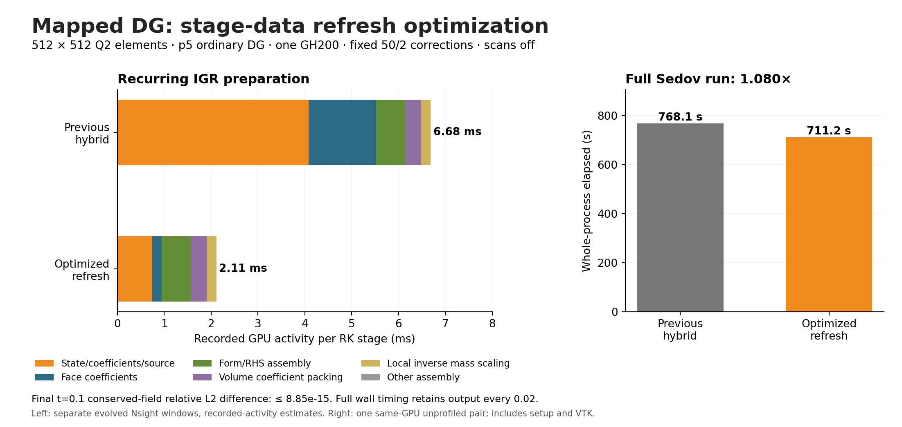

# Mapped-DG stage-data refresh optimization

This campaign optimizes the recurring preparation of the current IGR equation. It retains the previously validated two-correction local spectral method and full face coupling. It does not loosen the sigma approximation, change alpha, change quadrature, or introduce lower-precision stage arithmetic.

## Implementation and scope

Tested application source: `b6f20b909034e13614791b4b15031b02c0405f41`, branch `igr-stage-data-refresh`; frozen CUDA application SHA-256 `cc27f58382d492b728f9e839130d5334fb0da32c1a5db94ee0bdc85427f783c9`.

Comparison: previous mapped-hybrid source `b53b40a56facbd4a47b198239158764da82b6295`, frozen application `007acaade17c5ec6e9adfc7e3ebe796da8406a28ad606041da77888e4f0986c2`. This isolates refresh improvements over the current optimized hybrid, not over the original GPU solver or the Cartesian global spectral inverse.

Three changes accumulate:

1. Skip the unused single-valued coefficient projection when the exact side-dependent DG face operator is active. Explicit ingestion/debug diagnostics retain their requested behavior.
2. Factor side-density interpolation into four element endpoint traces and the actual tangential maps. Preserve orientation, density floors, local alpha and both vector orderings. The admitted path no longer constructs or reads the dense per-face shape table.
3. Fuse current-state volume preparation into two FP64 SIMT kernels: GL6 source/diffusion and GL7 inverse density. Values and derivatives remain on chip; energy is not interpolated unnecessarily. Use the full mapped Jacobian and the existing conservative quotient-rule / trace(G^2) algebra.

The full current FP64 operator, MFEM form/RHS assembly, initial projected inverse, and two corrections per RK stage remain unchanged. Local inverse applications still use the previously selected FP64 WMMA backend. These new refresh kernels are not TF32 operations. The large-case 50/2 updates remain an approximate closure without a current-residual convergence certificate; unchanged FP64 current-A arithmetic does not imply a converged sigma solve.

The two new paths remain selectable, with baseline/dense defaults and fallback for unsupported configurations:

```sh
export IGRLAB_IGR_COEFFICIENT_EXECUTION=fused
export IGRLAB_IGR_FACE_DENSITY_EXECUTION=tensor
```

Both fast paths currently require a single MPI rank and ordinary DG p5 GL quadrilaterals with fixed conforming Q1/Q2 mapped geometry. Volume fusion additionally requires exact GL7 mass and GL6 diffusion/source rules; Q1 cases using GL6 mass fall back. The compact face path retains its own GL6 face-rule checks; unsupported layouts/rules retain the previous implementation. This is not a claim of acceleration for every p order, DGSEM, HDG, nonconforming meshes or MPI.

## Native validation

DeltaAI job `3443660` completed successfully. Canonical `build.sh` preparation, build and all four selected tests passed: the new stage-refresh CUDA test (70 local cases, zero failures), exact-face CPU/CUDA tests, and projected local-tensor regression. Tests cover actual mapped geometry, independent host-MFEM coefficient/source oracles, changed device state/local alpha, density-floor semantics, vector ordering, cache replacement/invalidation, unsupported-rule fallback, and production A/RHS/FGMRES solve parity. This focused converged fixture is distinct from the large-case fixed-sweep mode.

## Fixed large case

One DeltaAI GH200, account `bdiy-dtai-gh`, partition `ghx4`, constraint `projects`, OMP=1. Fixed 512-by-512 Q2-mapped mesh (262,144 elements, 9,437,184 scalar DOFs, 37,748,736 conserved DOFs); ordinary DG p5, L2/BrokenL2, GL7 mass and GL6 diffusion/source, exact SIPG. Mesh SHA-256 `def0f9eabe4b39fa860c5856a77fa186ef83f859728d96de0fc25dc191657836`.

All arms use projected local FP64 WMMA inverse applications, 50 initialization corrections and two subsequent corrections, damping 0.7, max-h c_alpha=1/6, CFL=0.3, Euler row kernels and FP64 tensor face kernels. No NaN, admissibility or conservation scans; no modal or positivity limiter; no restart. Output interval is 0.02 for all timing comparisons.

## Short attribution run

Job `3443676`, same GPU on gh017, fresh evolution to t=0.0025, 162 accepted RK steps / 487 sigma calls each. One sequential sample per arm; unlocked clocks. These short runs validate equivalence and guide attribution, not the full-trajectory performance claim.

| Cumulative implementation | Pre-final-output analysis (s) | Native done (s) | Whole process (s) |
|---|---:|---:|---:|
| Previous hybrid | 17.093320 | 60.612773 | 172.433084 |
| Skip unused projection | 17.623443 | 60.190565 | 170.222191 |
| Add tensor face density | 16.246799 | 62.894952 | 175.026633 |
| Add fused volume preparation | 15.190616 | 58.266074 | 168.774525 |

Analysis elapsed excludes initialization/initial VTK and final output. Native `done` also excludes initialization/initial VTK but includes final output/reporting. Whole-process time includes setup, all output and teardown.

The combined short pre-final-output improvement is about 11.1%, but startup and VTK costs dominate total short runtime. No standalone benefit is resolved for the unused-projection removal. Do not assign the whole-process differences to device kernels.

One-second total-device snapshots recorded maxima of 27,649 / 27,395 / 25,617 / 24,355 MiB across these four arms: about 3.22 GiB less for the fully fused arm. Sampling can miss peaks and does not isolate a backend-specific allocation.

All complete native Q5 fields were compared on matching cells with the actual Q2 geometry and GL8 integration, outside timed application runs. Original versus skip is byte-identical, as is tensor-faces versus fully fused. Against the original, maximum conserved relative L2 difference is 6.210818707125411e-15; sigma relative L2 is 3.2926377133817686e-13. Maximum primary sampled normalized Linf is 1.3658882827365031e-12. These pass predeclared algebra-preserving thresholds (conserved L2 <=1e-10, sigma L2 <=1e-8, all five primary normalized sampled Linf <=1e-8).

## Full run and fresh profile

Matched job **3443733** completed original then fused on gh113, GH200 UUID `GPU-26b289b6-14ac-c162-8198-dda306da454a`. Both reached t=0.1 with 6,663 accepted RK steps, 19,990 sigma calls and 40,028 corrections. The original final VTU is byte-identical to the earlier hybrid run 3440138.

| Timing scope, seconds | Previous hybrid | Optimized refresh | Previous / optimized |
|---|---:|---:|---:|
| Pre-final-output Analysis elapsed | 608.620905 | 547.770990 | 1.111086× |
| Native done stopwatch | 655.549380 | 598.169274 | 1.095926× |
| Whole application process wall | 768.057105 | 711.212943 | 1.079926× |

The matched full run saves **56.844 seconds / 7.401% of whole-process time**. Pre-final-output elapsed falls 9.998%, but includes intermediate VTK saves and is not pure evolution. This is one sequential same-GPU observation with unlocked clocks, without a confidence interval. In samples after 130 seconds with at least 90% GPU utilization, both arms have median SM/memory clocks of 1,980/2,619 MHz; samples do not establish constant clocks or system isolation. The previous hybrid's wall time is within approximately 1% of its earlier 760.120-second observation. One-second sampled GPU-memory maxima again fall from 27,649 to 24,355 MiB (3.217 GiB less).

Complete final Q5 polynomial comparison on matching Q2 cells gives maximum conserved relative L2 difference **8.848645567510479e-15**, sigma relative L2 **3.9182947631496424e-13**, and maximum primary sampled normalized Linf **1.202250887813249e-12**. The same predeclared tight thresholds pass. Sampled density, pressure and q_sigma remain positive. This reports execution agreement at the final frame; the approximate sigma closure is unchanged.

A separate offline comparison with the retained converged FP64 t=0.1 fields reproduces the previous physical result: maximum conserved relative L2 **8.206696155040836e-7**, sigma relative L2 **0.015288468095394612** (1.52885%). No additional converged GPU run was required, and no new cumulative speedup against that earlier reference is claimed.

Fresh Nsight Systems job **3443736** follows the pair. Its trajectory starts continuously at t=0 and intentionally terminates after a 15-second evolved-state capture following 180 seconds of startup/evolution. Its diagnostic output cadence is 0.1 to keep VTK out of the captured window; unprofiled timing arms retain 0.02. Profile timing must not be substituted for full-run wall timing.

The fresh recorded-activity analysis retains 290 complete RK steps / 870 stages. Each stage has exactly two current-A applications and two local-P applications, and exactly one of each new refresh kernel. All 37,120 selected kernel launches and 9,570 selected memcpy calls match unique successful runtime/device activity records; there are no unmatched activities, correlation ambiguities or phase-accounting gaps. All 870 volume-pack → mass-scaling → current-A ordering checks pass.

| Recorded GPU activity per stage (ms) | Previous capture | Fresh capture |
|---|---:|---:|
| State interpolation / coefficient-source preparation¹ | 4.083079 | 0.742096 |
| Exact side-dependent face coefficient refresh | 1.436053 | 0.204621 |
| MFEM partial-form data and RHS integration | 0.618524 | 0.619685 |
| Current-volume coefficient packing | 0.344002 | 0.344299 |
| Local-P mass scaling | 0.202426 | 0.202734 |
| **Total recurring preparation** | **6.684084** | **2.113435** |
| Total sigma work | 11.262837 | 6.707878 |
| Euler spatial RHS | 9.883323 | 9.857298 |

¹ The previous coefficient/source group includes about 0.48445 ms of unused single-valued face projection. Excluding that removed work, useful volume preparation falls from about 3.59863 to 0.74210 ms. These are kernel-group changes between recorded windows, not independent unprofiled speedups for each patch.

Preparation's recorded GPU share falls **31.006% → 12.449%**; its recorded activity is **68.381% lower (baseline/new = 3.163×)**. Total sigma recorded GPU activity falls about 40.44%; sigma/Euler falls **1.13958 → 0.68050**. Euler time, current-A cost (1.69439 → 1.70093 ms/apply), local-P cost (0.20809 → 0.20971 ms/apply), and full-sweep cost stay within approximately 0.8%. This localizes the change to preparation. The new source/diffusion kernel runs the actual nonidentity B/G path; its cost is 0.42370 ms/stage. GL7 inverse density costs 0.14182 ms; element density traces and side packing cost 0.07155 and 0.06714 ms.

These are **recorded-activity estimates from separate GPUs/windows**, not an unprofiled paired GPU speedup or an integral over the full trajectory. Both traces retain Nsight's driver 13.2 / tracing-library 12.9 fallback and possible missing-event warnings; the new run also reports a temporary-filesystem space warning. The report and SQLite completed and their hashes/integrity were verified, but record reciprocity does not prove lossless capture. Host NVTX timings are asynchronous inclusive spans and must not be added to GPU timings. The sole direct whole-application performance claim remains the matched 7.401% time reduction above. Initialization, output and work outside the captured window mean a per-stage profile saving must not be extrapolated into a measured whole-run saving.

The unchanged Euler spatial RHS is now 58.06% of selected recorded GPU activity. Its weak-divergence row kernel is the largest individual kernel at 4.856 ms/stage. Remaining preparation is 2.113 ms, including 0.620 ms form/RHS assembly and 0.547 ms combined coefficient packing / local mass scaling. No lazy-PA change or further GPU experiment was added in this campaign.



The [compact benchmark record](benchmarks/igr-stage-data-refresh-20261023.json) binds tested source/binaries, exact arguments/environments, full and short run receipts, field hashes/comparisons and profile analysis. Raw evidence remains under `/projects/bdiy/jarias9/igrlab-deltaai-wmma-20261016/igr-stage-data-refresh-20261023`; concise records and local analysis are preserved in the matching `~/.cache/igrlab-experiments/igr-stage-data-refresh-20261023` folder. No full raw field or trace is placed in Git.
