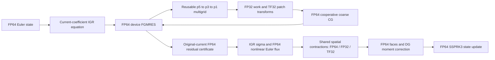

# DeltaAI results: DG/DGSEM tensor pipeline

The prototype integrates tensor p-multigrid, fused FP64 IGR volume application,
and shared Euler contractions into the existing DG/DGSEM application. All modes
remain opt-in. The completed comparisons below measure full application process
time against the current FP64 solver and physical agreement with its trajectory.

The main gain comes from the multigrid algorithm and, for DG, shared-reference
operator reformulation. Actual TF32 and FP64 Tensor Core execution is verified,
but the matched precision controls do not establish an additional TF32 speed
advantage. “Full TF32 candidate” below means TF32 MG transforms and shared Euler
contractions with FP64 WMMA volume; the complete simulation is not TF32.

At n32 over 100 steps, the full candidate is **2.71× faster for DG and 2.31× for DGSEM**.

At n64 over 100 steps, the full candidate is **1.95× faster for DG and 1.56× for DGSEM**.

At n32 over 1000 steps, the full candidate is **4.76× faster for DG and 3.84× for DGSEM**.

## Pipeline and precision boundaries

The fine IGR volume can use FP64 SIMT or FP64 WMMA, while exact DG faces remain
in the original path. Current mass and diffusion coefficients refresh every
solve. `IGRLAB_IGR_TENSOR_MG_REBUILD_INTERVAL=0` freezes only the approximate
preconditioner, not the physical equation. The hierarchy uses Galerkin coarsening
and overlapping separable patch smoothers. Its lowest sparse solve remains FP64.

DG's shared weak-divergence map operates on a 36×72 matrix with four real columns
per element, with FP64 centering and assembled-moment correction. DGSEM uses
6×6 shared line maps and 48 real columns per element. The original DGSEM control
retains its existing fused FP64 SIMT Euler residual; shared-map candidates use
the corresponding unfused spatial path. Shared-FP64 controls below still use
TF32 multigrid and FP64 WMMA volume: they isolate spatial contraction precision.

See the [implementation contract](igr_tensor_pipeline.md) for admission and selectors.

## Matched scientific and timing controls

The case is a smooth periodic active-IGR Euler wave, p5, SSPRK3, fixed dt `1e-4`.
The 100-step runs reach T=0.01; the 1000-step extension reaches T=0.1. These are
same-discretization reference comparisons, not analytic PDE error estimates.

| Mesh | Elements | Scalar IGR unknowns | Euler unknowns | Local alpha |
| --- | ---: | ---: | ---: | ---: |
| n32 | 1024 | 36,864 | 147,456 | 1/1024 |
| n64 | 4096 | 147,456 | 589,824 | 1/4096 |

`c_alpha=1` and alpha=h². All variants on a mesh use identical physical controls;
alpha changes between mesh sizes, so this is not fixed-PDE strong scaling.
All runs use one native ARM GH200 120GB GPU (SM90), one rank and eight allocated
CPU cores on DeltaAI, account `bdiy-dtai-gh`, partition `ghx4`, constraint `projects`.
The n32 production job ran on gh112; n64 ran on gh062. Long DG qualification
ran on gh036; its timing continuation and DGSEM long comparisons ran on gh083.

The original solver already uses device FP64 FGMRES, element-FP64/H1 two-level
preconditioning and cooperative coarse CG. All controls use ordered MGS,
restart 50, rtol `1e-10`, atol 0, and maximum 2000 outer iterations. Every candidate
solve must pass the original-current FP64 IGR equation at the evolving candidate
state. This certificate does not by itself certify the reduced-precision Euler
contraction; the separate physical checks below qualify that approximation.

Timings are unprofiled complete-process wall times, including fresh per-process setup,
first-use allocation, mandatory native checks and shutdown. One warmup per
variant is excluded, followed by three alternating measured samples. Field
output and optional event/residual diagnostics are disabled. The optional,
observational RK admissibility scan is explicitly disabled, while nonfinite
scans, actual numerical callbacks, conservation and IGR acceptance remain.
This is a defined production-compute scope, not every application's default.

Ranges below are observed minima/maxima, not confidence intervals. Speedups are
ratios of medians against the baseline in the same table. Immutable receipts
also retain median paired percentage reductions; those are distinct statistics.
Do not compare output-on qualification times or profiler-wrapper times as speedups.

## End-to-end combined pipeline, 100 steps

### n32

| Variant | DG seconds, median (range) | DG speedup | DGSEM seconds, median (range) | DGSEM speedup |
| --- | ---: | ---: | ---: | ---: |
| Current FP64 solver | 10.251 (10.083–10.313) | — | 8.759 (8.539–8.915) | — |
| TF32 MG + FP64 WMMA volume | 5.155 (5.124–5.234) | 1.99× | 3.944 (3.792–4.089) | 2.22× |
| TF32 MG/WMMA + shared Euler FP64 | 3.755 (3.698–3.905) | 2.73× | 3.900 (3.759–3.915) | 2.25× |
| TF32 MG/WMMA + shared Euler FP32 | 3.791 (3.732–3.917) | 2.70× | 3.855 (3.798–3.858) | 2.27× |
| TF32 MG/WMMA + shared Euler TF32 | 3.783 (3.713–3.796) | 2.71× | 3.796 (3.739–3.866) | 2.31× |

### n64

| Variant | DG seconds, median (range) | DG speedup | DGSEM seconds, median (range) | DGSEM speedup |
| --- | ---: | ---: | ---: | ---: |
| Current FP64 solver | 13.277 (13.191–13.313) | — | 11.739 (11.703–11.758) | — |
| TF32 MG + FP64 WMMA volume | 8.231 (8.188–8.391) | 1.61× | 7.266 (7.221–7.281) | 1.62× |
| TF32 MG/WMMA + shared Euler FP64 | 6.873 (6.810–6.982) | 1.93× | 7.473 (7.447–9.969) | 1.57× |
| TF32 MG/WMMA + shared Euler FP32 | 6.870 (6.794–6.962) | 1.93× | 7.492 (7.460–7.648) | 1.57× |
| TF32 MG/WMMA + shared Euler TF32 | 6.820 (6.814–6.973) | 1.95× | 7.510 (7.495–7.736) | 1.56× |

## Precision and volume controls, 100 steps

These controls keep the shared Euler selector off to isolate the solver changes.
The all-FP64 MG control measures the algorithm gain before reduced precision.
The two volume controls apply the same current FP64 physical volume equation.

### n32

| Variant | DG seconds, median (range) | DG speedup | DGSEM seconds, median (range) | DGSEM speedup |
| --- | ---: | ---: | ---: | ---: |
| Current FP64 solver | 10.357 (9.981–10.464) | — | 8.894 (8.564–8.946) | — |
| FP64 MG, original volume | 5.328 (5.145–5.357) | 1.94× | 3.984 (3.877–4.115) | 2.23× |
| FP32 MG, original volume | 5.074 (4.933–5.128) | 2.04× | 3.690 (3.690–3.809) | 2.41× |
| TF32 MG, original volume | 5.098 (5.088–5.143) | 2.03× | 3.817 (3.745–3.825) | 2.33× |
| TF32 MG + FP64 SIMT volume | 5.103 (5.027–5.182) | 2.03× | 3.774 (3.743–4.056) | 2.36× |
| TF32 MG + FP64 WMMA volume | 5.039 (5.038–5.074) | 2.06× | 3.786 (3.744–3.964) | 2.35× |

### n64

| Variant | DG seconds, median (range) | DG speedup | DGSEM seconds, median (range) | DGSEM speedup |
| --- | ---: | ---: | ---: | ---: |
| Current FP64 solver | 13.043 (13.011–13.130) | — | 11.835 (11.602–11.885) | — |
| FP64 MG, original volume | 8.383 (8.168–8.492) | 1.56× | 7.422 (7.382–7.625) | 1.59× |
| FP32 MG, original volume | 8.019 (7.979–8.101) | 1.63× | 7.343 (7.301–7.419) | 1.61× |
| TF32 MG, original volume | 8.094 (8.080–8.141) | 1.61× | 7.491 (7.388–7.528) | 1.58× |
| TF32 MG + FP64 SIMT volume | 8.160 (8.116–8.290) | 1.60× | 7.399 (7.354–7.414) | 1.60× |
| TF32 MG + FP64 WMMA volume | 8.020 (7.967–8.150) | 1.63× | 7.428 (7.413–7.610) | 1.59× |

## Sustained n32 run, 1000 steps

This extension uses full-trajectory physical qualification before its own
three-pair timings. DG qualification is from job `3396172`; DG timings and
DGSEM qualification/timings are from continuation `3396544`. It amortizes setup over ten times as many accepted timesteps;
it does not hold final physical time fixed while changing timestep.

| Variant | DG seconds, median (range) | DG speedup | DGSEM seconds, median (range) | DGSEM speedup |
| --- | ---: | ---: | ---: | ---: |
| Current FP64 solver | 81.506 (81.427–83.783) | — | 69.712 (68.628–69.764) | — |
| TF32 MG/WMMA + shared Euler TF32 | 17.118 (17.087–17.415) | 4.76× | 18.161 (18.151–19.679) | 3.84× |

## Physical accuracy

Every field-qualified run checks convergence of every IGR solve, accepted time
and RHS counts, finite fields, positive sampled density/pressure, nontrivial
evolution and native periodic conservation. Saved fields at five checkpoints
for 100 steps, and every 100 steps for the extension, are compared with FP64.
Integrals use the exported p5 polynomial; maxima and positivity are sampled.

Required budgets are normalized conserved L2≤`1e-3`, sampled Linf≤`1e-2`,
excess normalized invariant drift≤`1e-6`, initial conserved agreement≤`1e-12`,
and native conservation≤`5e-10`. For each component, normalized L2 is error RMS
divided by the larger of its physical initial-state scale and reference RMS.
To expose errors hidden by background scales, wave-relative RMS below compares
the mean-subtracted error to the mean-subtracted reference RMS. It is an
additional diagnostic, not a separate acceptance gate.

The following maxima cover conserved components and saved checkpoints for the
full TF32 candidate. Conservation is the native trajectory defect, a different
quantity from field difference. Pressure, velocity and IGR sigma diagnostics
are retained separately in the receipts.

| Case | Max normalized conserved L2 | Max sampled normalized Linf | Max wave-relative RMS difference | Native conservation defect | Max original-A relative residual |
| --- | ---: | ---: | ---: | ---: | ---: |
| n32, 100 steps, DG | 6.607e-07 | 2.066e-05 | 0.00510% | 3.686e-14 | 6.561e-12 |
| n32, 100 steps, DGSEM | 4.889e-07 | 2.388e-06 | 0.00329% | 4.050e-13 | 6.406e-12 |
| n64, 100 steps, DG | 5.480e-07 | 1.759e-05 | 0.00394% | 3.508e-14 | 1.941e-12 |
| n64, 100 steps, DGSEM | 2.698e-07 | 1.822e-06 | 0.00203% | 3.694e-14 | 1.950e-12 |
| n32, 1000 steps, DG | 2.277e-06 | 2.837e-05 | 0.01162% | 1.199e-13 | 6.561e-12 |
| n32, 1000 steps, DGSEM | 3.931e-06 | 8.762e-06 | 0.05296% | 1.618e-12 | 6.406e-12 |

The longer full-candidate trajectories remain inside every required budget.
At T=0.1, DGSEM energy and pressure fluctuation RMS are respectively 0.0502%
and 0.0532% below the FP64 reference; this small accumulated amplitude difference
is visible in addition to the background-normalized error. It supports retaining
DGSEM's fused FP64 Euler path, which was also faster at n64. This is a difference
from the discrete FP64 trajectory, not an analytic damping-error estimate.

All six isolated solver variants passed n16 smoke and n32/n64 100-step physical
qualification for both methods. Across the n32/n64 isolated qualifications, the
worst normalized conserved L2 differences were `1.10e-10` DG and `6.18e-16` DGSEM. The larger differences with shared TF32
are consistent with changing Euler contraction arithmetic rather than just the
preconditioner. No coarse-CG cap, failure, fallback or residual-replacement retry
was observed in the completed qualifications.

At n32, the combined FP64 spatial-map control differs from the original reference
by at most `8.27e-11` DG / `5.59e-16` DGSEM in normalized conserved L2; the FP32
spatial map gives `1.42e-10` / `2.75e-11`. These controls still have mixed-precision
MG. Native CUDA tests also passed for device Krylov, shared reference maps,
fused tensor volume and multigrid. Volume fixtures cover p1/3/5/7, GL/GLL,
separate quadratures, transformed geometry, tail batches and changing coefficients;
these fixture results do not broaden the full hierarchy's mesh admission.

## Execution proof and attribution

Exact executed kernel symbols from the saved SM90 binary contain
`HMMA.1684.F32.TF32` for MG and shared Euler maps, and `DMMA.8` for FP64 volume.
In each n32 full candidate profile, 33,712 MG TF32 transform launches, 2,709 FP64
WMMA volume launches and 300 shared TF32 Euler launches match native counters.
This proves executed Tensor Core kernels; it does not measure saturation,
occupancy, dynamic instruction counts or an incremental Tensor Core speedup.

The n32 DG profile attributes the shared-operator improvement to its spatial
work: the host DG/Mult span falls from about 1.53s to 0.21s. Shared contractions
alone cost only 3.38ms with FP64 SIMT versus 6.57ms with TF32 over 300 calls.
For DGSEM, DG/Mult stays around 0.35s; the existing fused spatial path was already
efficient. Its shared contractions cost 1.06ms FP64 versus 1.36ms TF32.
These are separate profiled runs, not the unprofiled timing samples above.

After both structural changes, DG IGR/update occupies about 1.51s of the 1.85s
profiled time loop. Principal candidate GPU costs include cooperative coarse
CG (274ms), MG TF32 transforms (182ms), pointwise Euler flux (138ms) and sparse
MG residual work (113ms). Nested host and GPU spans are not additive costs.
No dedicated coarse host range exists; coarse attribution uses its exact kernel
and native inner-iteration counts. Coarse iteration counts can differ between
spatial precision modes even with identical outer counts.

At n64, the DG profiled loop falls from 10.12s to 3.61s with the full candidate.
Shared restructuring removes about 1.38s of old contraction work. The shared
TF32 map takes 7.00ms versus 9.10ms for FP64: a small contraction-level benefit,
without an established material independent end-to-end gain. MG transforms
(331ms) now cost about as much as coarse CG (315ms); sparse residual work takes
214ms. The same exact-symbol instruction and native dispatch checks pass.

The n64 DGSEM profile corroborates the shared-path cost: DG/Mult grows from
1.201s with MG and fused Euler to 1.420s with the shared path. The shared TF32
contraction itself costs only 3.49ms (FP64: 2.41ms). Boundary-flux integration
and deterministic maxima take more time despite equal call counts; the trace
does not establish a hardware cause. Mandatory owned/face state scans remain
and cost about 618ms. These are separate from the removed observational scans.
All eight n64 captures pass exact tensor dispatch proof with zero coarse caps
or failures and no observational RK scan ranges.

The measured one-time MG setup is about 0.205s at n32 and 0.8s at n64, included
in full-process timing. Mixed hierarchy stencil storage is 32,112,640 and 128,450,560
bytes respectively; FP64 stores twice this. These figures are stencil storage,
not total peak GPU memory. Initial and endpoint projection work also contributes
fixed cost. Profiler capture/report lifecycle is never counted as application
startup or subtracted from the profiled loop to infer startup.

## Implications and limits

The evidence favors keeping the stronger multigrid and DG shared-reference
formulation as the primary direction. Equivalent FP64/FP32 controls are essential:
TF32 has passed this physical budget, but it is not yet the source of a demonstrated
additional end-to-end win. For DGSEM, retain the existing fused Euler path: at n64 the full shared-TF32
candidate takes 7.510s versus 7.266s with tensor MG/WMMA and the original fused
Euler residual, about 3.4% longer. The shared spatial path provides no clear
benefit in these cases.

Further solver optimization should target the measured remaining coarse-CG,
transform and launch costs. Better batching of real patch lines and carefully
fused smoothing are candidates, not measured improvements. Their numerical
rounding, padding and memory costs must be assessed before assuming a gain.

The 1000-step timing checker initially rejected the successful FP64 warmup
because its last step was shortened by `1.829e-15` to hit the endpoint, slightly
beyond the old fixed `1e-15` allowance. The private v6 replay validator bounds
only downward clipping by binary64 clock accumulation (`2.238e-14` here), keeps
the maximum step nominal, and retains exact work/horizon, non-adaptivity,
convergence, conservation and field-budget controls. It admits only the exact
pinned-v5 n32/1000-step pair after reconstructing controls and revalidating native
evidence. Physical qualification remains on stricter frozen v5. No sample from
the failed timing cohort is used; the complete timing cohort was restarted.
Application source and executable did not change.

This prototype is limited to one CUDA rank, uniform axis-aligned periodic quads,
scalar nodal L2 spaces and the p5 hierarchy. It has not established shock accuracy,
robustness to large coefficient changes, curved-mesh pipeline support, MPI
scaling, mesh-independent convergence or GPU saturation. The evolving equation
remains current, but one frozen hierarchy is demonstrated only over the tested
smooth trajectories. No default selection is changed.

## Tested source and retained evidence

Application commit: `61938a7a8f7f21aef74ada6ade3f77308a1653d3`, on branch
`igr-tensor-multigrid-deltaai`; canonical DeltaAI build job `3395555`.
The executed source was base `a98f9913027a9b2a4407f49affc15d65949e62cc` plus
`overlay-tensor-pipeline-v3`. All 60 payload hashes match the local commit,
covering all production/build/test changes. Two documentation-only base
differences remain; this is not a whole-checkout equivalence claim.

- Overlay manifest SHA256: `dee3081a947cdc7083b7e72cbc668c58b6be144bcdf76058d8bf8555fff41aa1`.
- Executable SHA256: `8209ec67ad4b95fe0d6ba2d95b2fb7b2c8e926e75a9541ab522e611c244cf74a`.
- Frozen v5 physical/100-step timing helper archive SHA256: `9edf228312010d40971d6ee0fe8b0c66027edcf84ec8151776a0dc5c59dde9e2`; 58 host tests passed and independent review found no blocker.
- Frozen v6 long-timing helper archive SHA256: `22bd046f04f56280d105636083fc5eef01e249e300caaa74d239292e79b7292f`; 67 host tests passed, including 9 endpoint/compatibility regression checks; independent review found no blocker.
- Native qualification job `3395652`; initial execution proof `3395667`.
- Production n32/n64 jobs `3396038` / `3396039`; long DG physical job `3396172` and continuation `3396544`.

Remote evidence root on DeltaAI:
`/projects/bdiy/jarias9/igrlab-deltaai-wmma-20261016`.

| Evidence | Path relative to remote root |
| --- | --- |
| Source manifest | `overlay-tensor-pipeline-v3/manifest.json` |
| Saved executable and build receipt | `tensor-pipeline-deltaai-v3/` |
| Frozen comparison tools | `tensor-tools-v5/` (physical and 100-step timing), `tensor-tools-v6/` (long timing) |
| Isolated n32/n64 field qualifications | `igr-pipeline-results/scale-100-3395670/`, `scale-100-3395671/` |
| Production n32 fields/timings/profiles | `igr-pipeline-results/production-n32-3396038/` |
| Production n64 fields/timings/profiles | `igr-pipeline-results/production-n64-3396039/` |
| Long DG physical qualification | `igr-pipeline-results/combined-long-3396172/fields-dg/` |
| Long timings and DGSEM qualification | `igr-pipeline-results/combined-long-continuation-3396544/` |
| Failed timing receipt and application logs | `igr-pipeline-results/combined-long-3396172/timing-dg/` (excluded) |

Compact receipts, scripts, manifests, source overlays and profile assessments
are mirrored locally under
`/home/jarias9/.cache/igrlab-build/evidence/igr-tensor-multigrid-20261016`.
Each receipt records exact argv/environment, source/binary/mesh identity,
accepted work, checks and comparisons. Raw fields and profiler captures remain
on DeltaAI. Reproduction should use these exact controls and `build.sh`.

Earlier output-free runs retained expensive optional observational RK scans;
they measured n32 speedups around 1.3× and n64 DG around 1.1×. They remain in
the evidence for their explicitly different timing scope and are not the primary
performance comparison. Source audit and profiles verified scan removal did
not remove numerical callbacks. Field qualification continued to retain scans.
The partial older n64 DGSEM timing was intentionally stopped after both field
qualifications and DG timing completed; it contributes no result here.
Superseded pending jobs and initial build/harness corrections are recorded in
`jobs.json`; no failed or incomplete run is represented as a passed measurement.
