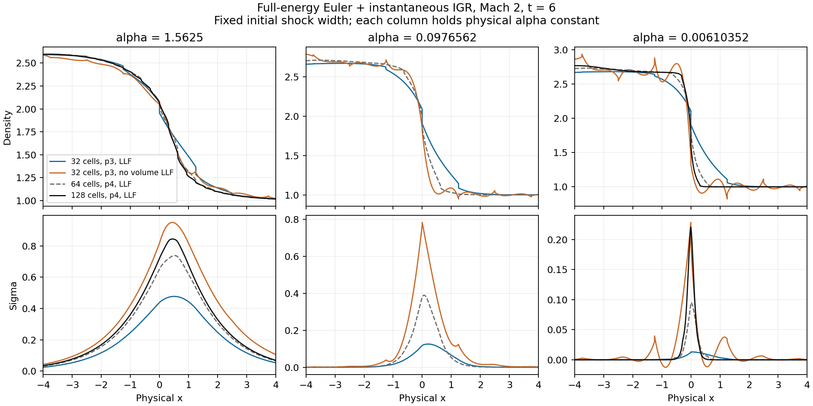
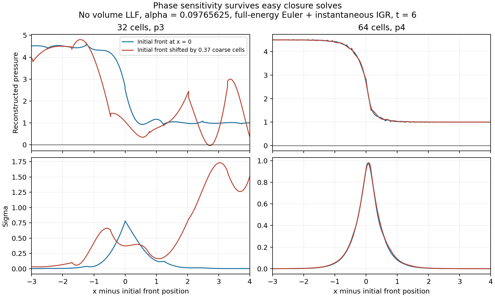

# hp-local IGR, face correction, and joint space-time investigation

This follow-up tests whether a p-dependent screening length can change the
algorithmic structure of full-energy Euler plus instantaneous IGR. It extends
the previous four-route screen with three independent research prototypes and
advancing planar-shock application controls. Research variations of alpha are
not adopted as a new production target. No new tensor-core speedup is claimed.

## What the mathematics predicts

For a frozen constant density in one dimension, the closure is

\[
\sigma-\ell^2\sigma_{xx}=\rho b,\qquad
\ell=\sqrt\alpha=\sqrt C\,h/(p+1)^{s/2}.
\]

The homogeneous response inside an element can be eliminated exactly. Its
outward conormal derivatives `(alpha/rho) partial_n sigma` depend on the two
endpoint values through

\[
D_K=\frac{\ell}{\rho}
\begin{bmatrix}
\coth(h/\ell)&-\operatorname{csch}(h/\ell)\\
-\operatorname{csch}(h/\ell)&\coth(h/\ell)
\end{bmatrix}.
\]

The physical diffusive flux `q=-(alpha/rho) grad(sigma)` has the opposite
sign. There is also a source-dependent conormal vector. The opposite-face/self-face
coefficient ratio is `sech(h/ell)`. Consequently smaller alpha suppresses
transmission between different faces of an element. The two traces meeting at
the same physical face still require flux matching. A source within O(ell) of
that face also interacts strongly with the adjacent element. **The useful
local unit is an interior solve plus paired face/vertex blocks, or a patch
following a front; it is not generally an isolated element.**

The approximation and solver incentives differ:

| Quantity | Scaling for alpha = C h²/(p+1)^s |
|---|---|
| Screening length / element size | sqrt(C) (p+1)^(-s/2) |
| Screening length / typical interior node spacing | sqrt(C) (p+1)^(1-s/2) |
| Screening length / LGL endpoint spacing | sqrt(C) (p+1)^(2-s/2) |
| Largest reaction-scaled diffusion eigenvalue, inverse-estimate scale | C (p+1)^(4-s) |

Thus s=2 makes the closure more local without increasing the approximate
number of interior samples across its shrinking front. s=4 removes the worst
p growth in the diffusion estimate but increasingly underresolves interior
fronts. Endpoint clustering gives face-aligned fronts a different behavior.
These estimates motivate phase tests; they are not error bounds for every
state.

A milder law is also possible: for **0<s<2**, screening shrinks relative to h
while the number of interior samples across the layer can still grow with p.
The tradeoff is that reaction-scaled stiffness continues to grow, making good
face conditioning more valuable. This interval should not be excluded merely
because the square and fourth-power scalings are attractive to the solver.

The production local alpha policy uses the minimum Jacobian singular value as
h and has no p dependence. The screen implements uniform-p scalings through
the existing C-alpha option. It uses the raw `(p+1)^(-s)` convention: it does
not silently recalibrate C to preserve the p1 value. For application accuracy
comparisons, each alpha is held fixed while p or h changes. Different alpha
families solve different finite-resolution regularized problems.

## Face-local algebra: a positive structural result

The new [face probe](../../tests/research/igr_hp_face_probe.py) uses actual
production frozen A and b, transforms GL coefficients to an LGL trace/interior
basis, eliminates the element-local interiors, and compares four Schur metrics.
It checks the original current-operator residual and physical/energy errors.
Eighteen operators produced 72 metric comparisons. Exact reference solves and
eigenvalue audits are charged CPU research oracles.

For the 4×4 compression problem, face-node condition numbers at p3/5/7 change
from 26.3/46.6/70.5 with alpha=h² to 2.92/3.62/4.57 with alpha=h²/(p+1)².
At current residual tolerance 1e-8, oracle-bound Chebyshev changes from
49/67/83 stages to 15/17/19. Locally constructed bounds require 27/28/35;
CG requires 13/14/14. Bounds require matrix construction and sometimes
neighborhood powers, not just an inexpensive scalar guess.

Larger paired-whole-face blocks absorb tangential coupling. On the stretched
saved planar p5 state with s=2, face-node CG/oracle-Chebyshev/local-bound-
Chebyshev counts 19/29/79 become 14/25/45. Factor entries increase from
1,012 to 3,292, with a largest block of eight unknowns. On p7 compression the
largest whole-face block has twelve unknowns. These sizes and recurring local
matrix actions are plausible batched tensor work, but packing, precision,
setup amortization and complete GPU execution have not been measured here.

Strictly independent element Neumann solves remain inaccurate. Even s=4
leaves sigma L2 errors of 12.7% and 8.21% on saved planar p3/p5 states, with
energy errors 36.8% and 24.1%. Shrinking alpha alone does not justify deleting
face communication. Dense precomposition of several correction stages also
lost locality and incurred substantial setup/fill; that direct version was
stopped. Details and cost counts are in the [face findings](igr_hp_face_findings.md).

## Representing the narrowing front

The [front probe](../../tests/research/igr_hp_front_probe.py) reuses the existing
full-energy Mach-2 stationary profile, including its non-polynomial sonic cusp.
It separates best L2 polynomial projection, nodal interpolation, noisy profile
location fitting, conserved-mass location inference, and a free local width.
It tests actual nonlinear source moments `2 alpha u_x²`, not density alone.
The exact stationary profile is a trustworthy reference for this reduced
question; it is not a claim that every evolving shock follows that template.

At s=2, front-normalized best-L2 density error improves for face-aligned fronts
as p increases but stays approximately constant for interior fronts. At s=4,
interior error worsens and some polynomial reconstructions have negative
pressure. High p and even/odd order controls confirm that phase matters.

Conserved means retain location information when point samples saturate into
far-field states. For a patch enclosing the front,

\[
\frac{dM}{dx_f}=\rho(x_L)-\rho(x_R),\qquad
\frac{|\delta x_f|}{\ell}\approx
\frac{|\delta M|}{|\Delta\rho|h}\frac{h}{\ell}.
\]

This gives a useful accuracy budget for a conservatively evolved front
coordinate. It does not permit arbitrary low precision in those means.
Point-sample fits can become non-identifiable as ell falls below node spacing.
Moreover, a known profile template is insufficient for shape variations:
allowing its width to vary still leaves substantial nonlinear-source bias
under a 2%-jump distortion. See the [front findings](igr_hp_front_findings.md)
for normalization, positivity, reference refinements and imperfect-data tests.

A final 96-record s=1 control tested that milder alternative without changing
the probe. At an interior centered front, best-L2 density error normalized by
jump*sqrt(ell) decreases from .0241 to .0152 to .00948 at p3/7/15; all tested
polynomial states remain positive on the quadrature. LGL reconstruction's
worst source-moment error across the four phases decreases from 31.0% to 22.3%
to 17.1%, while the best-L2 source remains nonmonotone. Thus a milder p law is a
real approximation improvement over s=2/4, but still does not by itself meet a
1% source gate. Its advancing application and face-conditioned GPU costs were
not tested. This brings the front screen to 1,952 retained records, including
the primary 1,856-record campaign and this additional control.

## Joint space-time solves

The [joint prototype](../../tests/research/screened_spacetime_probe.cpp) solves
both Gauss stage states and sigma in a retained chord-Newton system. It retains
current closure equations, current conservative face fluxes and all
coefficient costs. Four 56×56 two-element factors are compared with a full
224×224 oracle, including factor construction, backtracking and failures.
This is a different method from the earlier alternating Picard/history branch.

Smaller alpha and moving block boundaries away from the compression fronts
substantially reduce nonlinear iterations. For s=2, a practical-tolerance
shifted-block run takes 98 iterations versus 292 without the shift. Both
closure length sqrt(alpha) and Euler propagation distance a*dt matter for
joint locality.

The tested CPU implementation still loses at matched accuracy. At t=.128,
shifted joint Gauss and RK4 both meet a 4e-6 relative state-error budget, but
joint takes .01371 s versus .001543 s, about 8.9 times longer. A stricter common-
quality control is about 8.5 times slower. Smooth temporal convergence is
fourth order; compression does not show uniform fourth-order refinement.
Rebuilding a failed retained factor can restore horizon completion, so those
failures must not be called a Gauss stability barrier.

This implementation branch was stopped. CPU timing and coefficient counts do
not rule out a substantially different fused GPU joint algorithm. Its tensor
implementation is untested. The [joint findings](igr_joint_spacetime_findings.md)
record equations, tolerances, numerical references, endpoint treatment and
complete attempted work.

## Advancing shocked application

Thirty-seven complete RTX5080 runs reached `t=6`, with zero rejected attempts
and current final-closure certificates. They used the existing planar Mach-2
case, full-energy DGSEM, L2/BrokenL2 IGR, exact DG faces, Rusanov surface fluxes,
Zhang–Shu limiting and SSPRK104. All process timings include setup, conversions,
coefficient construction, transport, faces, all stages, conservation accounting
and initial/final VTK output. Total measured child-process time was 1,031.56 s.
No remote resources were used.

The default initializer changes its physical width when the usual refinement
flag changes. Custom 32/64/128-by-1 meshes with `--serial-refine 0` held the
initial tanh width at 1.25; C-alpha was rescaled to keep physical alpha fixed.
New optional `--shock-width` and `--shock-x` controls make this explicit through
the existing case. An initial-coefficient comparison verified that explicitly
requesting width 1.25 reproduces the old default bit for bit.

The three physical alpha values were 1.5625, .09765625 and .006103515625. On the
32-cell p3 mesh these correspond to C=1, 1/16 and 1/256, respectively. The same
C is **not** used after h refinement: for example the middle-alpha 64-cell p4
case uses C=.25. These are fixed-alpha approximation controls, not a claim to
have implemented a universal evolving hp policy.

With volume LLF retained, p3 differences from the finest tested calculation
were:

| Physical alpha | Finer comparison | Density relative L2 difference | Sigma relative L2 difference |
|---|---|---:|---:|
| 1.5625 | 128 cells, p4, LLF | 1.27% | 36.7% |
| .09765625 | 128 cells, p4, no volume LLF | 2.89% | 83.3% |
| .006103515625 | 128 cells, p4, LLF | 3.48% | 92.5% |

These are differences of reconstructed conservative/sigma polynomials at common
physical quadrature points, not asserted exact continuum errors. The LLF
references are still changing: 64-to-128-cell p4 sigma differences are 9.69%
and 53.2% in the first and third families. That lack of spatial convergence is
itself a reason to reject a claim of accurate p-scaled performance. For the
smallest-alpha coarse case, halving dt changes density by only 1.92e-10 and
sigma by 1.68e-9 relative L2, so temporal error does not explain the large
spatial/source discrepancy.



### A useful numerical candidate, with a decisive phase limitation

Removing volume LLF is an existing discretization option, not a new continuum
model. It substantially improves the shorter-alpha shock on a sufficiently
resolved grid. The middle-alpha p4 case gives the strongest new advancing
candidate:

| 64-cell p4 configuration, alpha=.09765625 | Complete process time | Density difference to 128-cell p4 no-LLF | Sigma difference |
|---|---:|---:|---:|
| Volume LLF | 11.802 s | 1.209% | 54.906% |
| No volume LLF | 11.767 s | 0.138% | 1.556% |

Both use dt=.025, linear rtol=1e-3, the retained FP64 global inverse, fused
ordinary CUDA, conservation accounting and diagnostic scans off. The timings
are single observations; their 0.3% difference is not a resolved speedup. The
material result is much better shock/closure agreement at essentially the same
cost. The no-LLF reference uses dt=.0125, rtol=1e-8 and the same physical alpha
and initial condition. A same-grid step/tolerance control changes the fields
far less than the spatial differences. This supports continued investigation
of the numerical candidate, not a certified 1.56% bound on continuum error.

It is unsafe to extrapolate that result to an unresolved front. At p3 on 32
cells, shifting the initial front by .37h changes the no-LLF result dramatically:
reconstructed pressure reaches **-0.03305 at x=3.18359**, although saved output
nodes have positive pressure and the run reaches its horizon with a certified
closure. Its sigma differs by about five times the norm of the 64-cell p4
no-LLF shifted calculation. At p4 on 64 cells both phases have positive sampled reconstructed pressure; the
translation-aligned sigma difference over the central window is about 3.0%.
This phase diagnostic has tiny nonzero initial tails and fixed far boundaries,
so it is not presented as an exact continuum translation identity.



Frozen exports of these two *evolved* p3 no-LLF states confirm that their
closure algebra is still easy. Whole-face condition numbers are 5.986 and
6.098, with 15 CG iterations in either case, versus 21/25 for element-trace
blocks. Yet independent element sigma errors are 29.6%/30.9% in L2 and
186%/195% in energy. The pressure pathology is invisible to the closure
conditioning. This is direct evidence that a faster, accurate linear solve is
not sufficient for an accurate shocked computation.

### Precision and complete solver costs

For p3 on 32 cells at the smallest alpha, practical current-solve controls used
dt=.05, rtol=1e-3 and the same low-overhead diagnostic configuration:

| Solver/preconditioner | Complete process time | Total iterations |
|---|---:|---:|
| FP64 retained global inverse + CG | 4.376 s | 3,370 |
| Ordinary Chebyshev degree 2 + CG | 6.452 s | 7,197 |
| Element-local FP64 inverse + FGMRES | 6.356 s | 8,956 |
| Element-local FP32 inverse + FGMRES | 6.347 s | 8,956 |

These are single-run screens. FP32 and FP64 local applications are unresolved
in time, and both lose to the strong small-problem dense control. Their
conserved fields differ from the strict same-grid dt=.025 reference by about
2.5e-9 in density and 2e-8 in sigma. That excellent algebraic/temporal agreement
coexists with large spatial error; it is not an accurate-shock speedup. The
global inverse is capped and not a scalable general solution.

Across all runs, the maximum reported conservation-balance relative defect is
1.32e-12. Source integrals computed with 48 versus 96 Gauss points per element
agree within 1.66e-14 relative. These checks distinguish quadrature, conservation
and closure success from the front-representation failure.

## Practical interpretation

The strongest new structural candidate is a representation based on conservative front moments
with compatible weak nonlinear moments, local interior response, and coupled
face/vertex correction. A p-dependent scale can make its response solves much
cheaper. The unresolved problem is obtaining accurate source moments and
transmission for an evolving, imperfectly resolved front without relying on a
known stationary shape. Better conditioning cannot substitute for that test.

For fixed end states, the proposed density-moment coordinate has an explicit
conservative evolution. Define the signed jump `Delta rho = rho_right-rho_left`.
If `M = constant - Delta rho*x_f + ell*c_profile`, then

\[
\dot x_f=\frac{f_{\rm mass}(x_R)-f_{\rm mass}(x_L)
+c_{\rm profile}\dot\ell}{\Delta\rho}.
\]

At fixed ell this recovers Rankine–Hugoniot motion. Changing h or p and therefore
ell requires the shape-mass term. The present fit constrains only density mass;
conserving independent momentum and energy moments needs additional residual
coefficients or constraints. This is a derivation for the next prototype, not
a completed conservative Euler method. The tested H1-weighted value-jump
recovery also fails to repair source localization robustly; it is the identity
on matching LGL traces and can spread derivative ringing.

A production implementation should first pass a moving-front or interacting-
shock test with conservative means, imperfect phase/shape, positivity and
current closure/flux checks. A bounded batched tensor/ordinary-CUDA probe can
proceed alongside that accuracy work, using the measured local block sizes and
charging setup and correction. A production choice needs both gates. Local RTX5080 application evidence cannot establish
performance on H100/H200/B200. Dense block throughput must be measured at the
actual chosen arithmetic, including correction, layout and setup costs.

## Tested identities and reproduction

Implementation commit: `3831ce381e97ed1a0a0ac937059c9437ebfdd8e2`;
source tree: `39c9d628d19ec86af7161e57b8a13b9ed3d076b1`.
The [results archive](igr_hp_breakthrough_results.json) contains every
application command, per-run executable hash, mesh/nodal inputs, source hashes,
research outputs and validation records. The final planar binary SHA256 is
`ce01d553874d2fbeafd8457d0ecb1e5c6a57afc5993205e3cea4fc70c168f313`.
Earlier runs used the unchanged preceding application binary; the archive
identifies both. Early exploratory joint v1 rows have a binary identity but no
captured source-file hash; the decisive v2 comparisons have both identities.

Hardware was RTX5080, driver 610.62, 16,303 MiB, CUDA13.3, one rank and one host
thread. Canonical profile was app SM120 / MFEM80-virtual, MFEM pin
`d9d6526cc1749980a2ba1da16e2c1ca1e07d82ec`. CPU research probes and compilation
were kept outside measured GPU windows. All five focused canonical tests passed:
frozen scalar algebra, frozen operator export, joint space-time, ordinary CUDA
DGSEM operator and screened CUDA preconditioners. Both new mathematical Python
self-tests passed; application polynomial analysis was independently reviewed,
including mean/derivative layout and rational-source quadrature refinement.

```bash
source /home/jarias9/spack/share/spack/setup-env.sh
flock -n /tmp/dg-igr-gpu0.lock ./build.sh --gpu --cuda-arch 120 --hdg-runtime \
  --no-clean --no-deps -j 16 --test-regex \
  '^dg_igr_(screened_spacetime_cpu|local_operator_cpu|frozen_scalar_igr_algebra_tests|igr_screened_patch_cuda|dgsem_operator_cuda)$'
```

Set `BUILD` to the output reported by that driver. A small reproducible frozen
screen is:

```bash
"$BUILD/tests/dg_igr_local_operator_probe" --nx 4 --ny 4 --order 3 \
  --c-alpha .0625 --output /tmp/igr-hp-p3.json
OPENBLAS_NUM_THREADS=1 python3 tests/research/igr_hp_face_probe.py \
  /tmp/igr-hp-p3.json --output /tmp/igr-hp-face.json --max-stages 256
OPENBLAS_NUM_THREADS=1 python3 tests/research/igr_hp_front_probe.py \
  --orders 3 7 15 --exponents 0 2 4 --output /tmp/igr-hp-front.json
```

The archive includes the exact 64/128-cell mesh text and input preparation
scripts. With the archived 64-cell mesh at the stated path, the promising
application configuration is:

```bash
flock -n /tmp/dg-igr-gpu0.lock python3 scripts/perf/dgsem_precision_horizon.py \
  --executable "$BUILD/examples/inoue_hattori_stationary_shock_1dy/inoue_hattori_stationary_shock_1dy" \
  --case stationary-shock --mesh /tmp/igr-hp-breakthrough/planar-nx64.mesh \
  --order 4 --dt .025 --final-time 6 --c-alpha .25 \
  --shock-width 1.25 --shock-x 0 --linear-rtol 1e-3 \
  --dense-inverse fp64 --dense-setup cusolver --integrator ssprk104 \
  --volume-dissipation none --positivity-limiter zhangshu --fused-residual \
  --diagnostic-scans off --conservation-balance --output-dir /tmp/igr-hp-p4-new
```

Use a fresh output directory. The paired ordinary control changes only
`--volume-dissipation llf`; the strict same-grid check uses dt=.0125 and
rtol=1e-8. Physical alpha must remain fixed when changing the mesh. No default
alpha policy, production gradient reconstruction or production time integrator
was replaced by this investigation.
